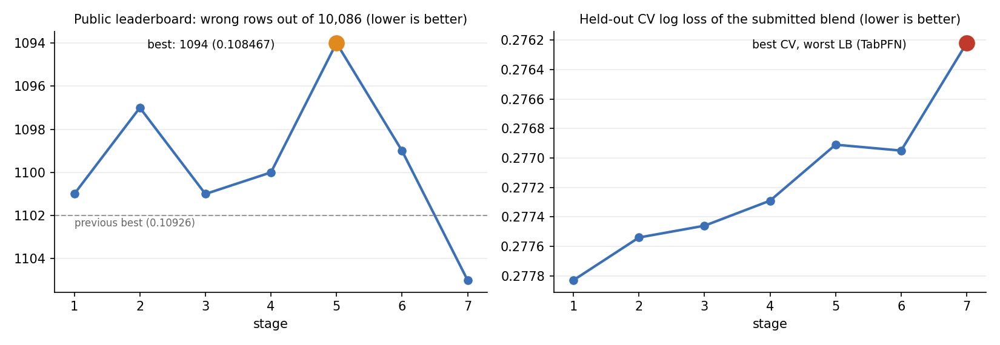

# Financial Inclusion in Africa — predicting bank account ownership

Predicting which individuals in Kenya, Rwanda, Tanzania and Uganda have a bank account, from 10 survey columns
([Zindi: Financial Inclusion in Africa](https://zindi.africa/competitions/financial-inclusion-in-africa)).
Metric: classification error rate on 10,086 test respondents (lower is better).

**Result: 0.108467 public leaderboard error (1,094 wrong rows), up from 0.10926 — rank 372 → 187.**
Built in seven iterative stages, from a gradient-boosting baseline to tabular foundation models (TabICL, TabPFN),
modern tabular MLPs (TabM) and Optuna-tuned CatBoost, all trained on Kaggle GPUs.



## Results by stage

| stage | notebook | what changed | CV logloss | public LB | wrong rows |
|---|---|---|---|---|---|
| 0 | — | earlier single CatBoost + Optuna | — | 0.109260 | 1102 |
| 1 | [baseline ensemble](notebooks/01_baseline_gbdt_logreg_blend.ipynb) | CatBoost + LightGBM + crossed logistic regression, log-loss blend | 0.27783 | 0.109161 | 1101 |
| 2 | [count features, embeddings, stacking](notebooks/02_count_features_embeddings_stacking.ipynb) | target-free count features, entity-embedding NN, country stacker | 0.27754 | 0.108765 | 1097 |
| 3 | [CPU CatBoost, four combiners](notebooks/03_cpu_catboost_and_combiners.ipynb) | ordered boosting, extra-trees LightGBM, combiners ranked on held-out logloss | 0.27746 | 0.109161 | 1101 |
| 4 | [CatBoost variants, full refits](notebooks/04_catboost_variants_full_refit.ipynb) | four CPU CatBoost variants, 100%-data refits, SLSQP blend | 0.27729 | 0.109062 | 1100 |
| **5** | [**foundation models + Optuna**](notebooks/05_foundation_models_tabicl_tabm_optuna.ipynb) | **TabICL, TabM, RealMLP, Optuna CatBoost (94 trials)** | **0.27691** | **0.108467** | **1094** |
| 6 | [scaled foundation models](notebooks/06_scaled_foundation_models.ipynb) | TabICL ×32 estimators, ordinal TabICL, 8-seed TabM | 0.27695 | 0.108963 | 1099 |
| 7 | [TabPFN](notebooks/07_tabpfn_cv_vs_leaderboard.ipynb) | TabPFN v3.5 (blend weight 0.84) | 0.27622 | 0.109558 | 1105 |

CV logloss is the held-out (out-of-fold, then cross-validated blend) log loss of the submitted blend.
The full story, with what each stage taught and why the next one looked the way it did, is in **[JOURNEY.md](docs/JOURNEY.md)**.

## Key lessons

1. **Optimise the metric that predicts the leaderboard, not the one you are scored on.** CV *error rate* is too noisy
   at this scale (one row ≈ 0.00004); CV *log loss* ranked the first three submissions in exact leaderboard order and
   picked out the best stage (5).
2. **Know the leaderboard's resolution.** Every score is an exact multiple of 1/10,086: the leaderboard counts wrong rows.
   Two submissions that differ on ~50 rows can swing by ±7 rows by chance, so small LB differences are noise.
3. **Model diversity beats model tuning once trees saturate.** Stages 3–4 squeezed tree models; stage 5's foundation
   models and MLPs delivered the largest real gain (−0.00039 CV logloss) and the best leaderboard score.
4. **The data has a ceiling.** Fifteen models from five families all land at 11.1–11.4% CV error; 32% of training rows
   have exact feature-duplicates, 7% of which disagree on the label. Better models reshuffle borderline rows.
5. **Foundation models can fool your CV.** TabPFN gave the best CV of the project and one of the worst leaderboard
   scores. A plausible cause is pretraining contamination (the public training rows may be in its pretraining data while
   the test labels never were). Validate foundation models on data they cannot have seen.

## Methods

- **Validation:** repeated stratified 5-fold CV with identical splits for every model and seed; each blend is scored by
  a second, outer CV over the out-of-fold matrix so combiners are never graded on rows they were fitted on.
- **Models:** CatBoost (GPU and CPU/ordered boosting, Optuna-tuned), LightGBM (standard and extra-trees), logistic
  regression on one-hot pairwise and three-way crosses, PyTorch entity-embedding MLP, TabM and RealMLP (`pytabkit`),
  TabICL and TabPFN (tabular foundation models).
- **Features:** the 10 raw columns (`year` dropped; it maps 1:1 to country), plus target-free count features computed
  over train+test. No external data.
- **Combining:** log-loss-optimal probability blend (SLSQP on the simplex) and logit-space logistic blend; the cutoff
  only moves off 0.5 if the gain beats a noise floor.
- **Reuse:** from stage 4 on, every model's out-of-fold and test predictions are saved, so later stages add models
  without retraining earlier ones.

## Reproducing

The competition data is not redistributed here; see [data/README.md](data/README.md).

1. Upload `Train.csv` and `Test.csv` to Kaggle as a private dataset.
2. Open a notebook on Kaggle, attach the dataset, choose **GPU T4 x2**, turn **Internet on** (stages 5–7 `pip install`
   their libraries), and *Run All*.
3. Stages 1–4 are standalone. Later stages read earlier stages' saved predictions, found anywhere under `/kaggle/input`
   (upload them as a dataset):

   | stage | needs | saves |
   |---|---|---|
   | 3 | — | `oof_v3.csv`, `test_probabilities_v3.csv` |
   | 4 | stage 3 files (optional) | `oof_v4.csv`, `test_probabilities_v4_{fold,full}.csv` |
   | 5 | stage 4 files | `oof_v5.csv`, `test_probabilities_v5_{fold,full}.csv` |
   | 6 | stages 4–5 files | `oof_v6.csv`, `test_probabilities_v6_{fold,full}.csv` |
   | 7 | stages 4–6 files | `oof_v7.csv`, `test_probabilities_v7_{fold,full}.csv` |

4. TabPFN (stages 5–7) needs a free token from [Prior Labs](https://ux.priorlabs.ai) with the license accepted,
   stored as the Kaggle secret `TABPFN_TOKEN`. Its weights are licensed for non-commercial use.

Runtimes on a Kaggle T4: 25–110 minutes per stage (stage 6 ≈ 2 h). `requirements.txt` lists the libraries.

## Repository layout

```
notebooks/   seven executed Kaggle notebooks, one per stage, with outputs
docs/        JOURNEY.md: the stage-by-stage narrative
assets/      figures
data/        where to get the data (not included)
```

## License

Code: [MIT](LICENSE). The competition data belongs to Zindi and its partners and is subject to their terms.
